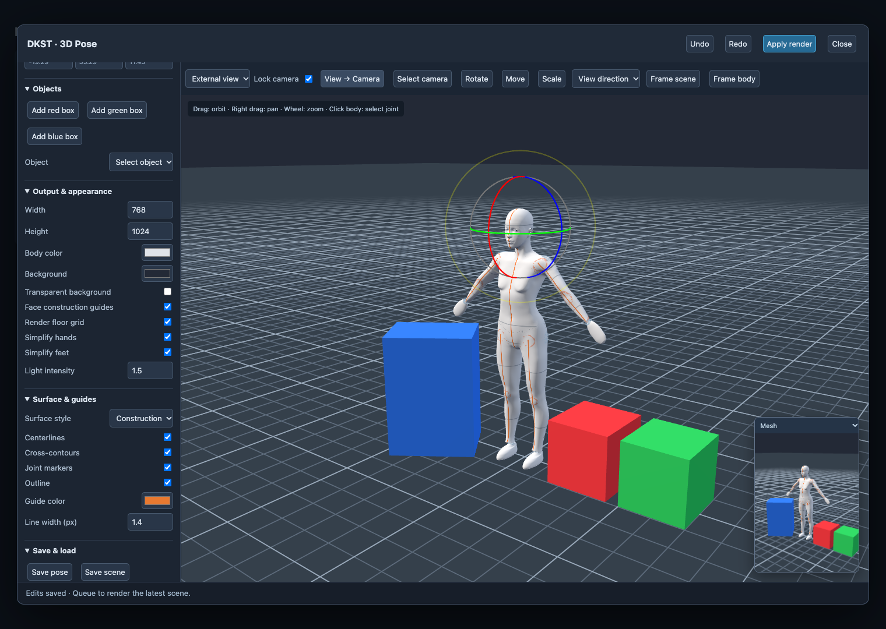
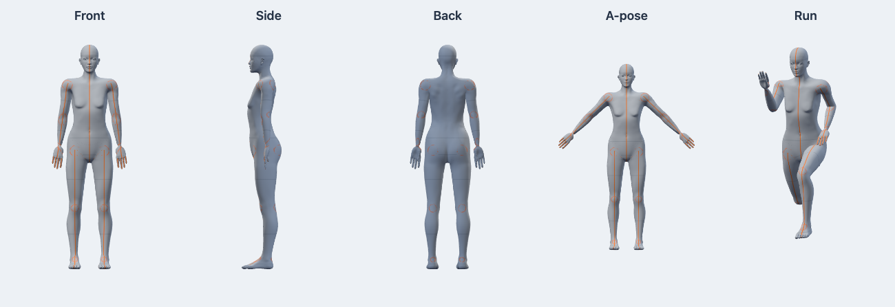

# ComfyUI-DINKIssTyle-3D-Pose

ComfyUI 안에서 3D 마네킹, 박스와 촬영 카메라를 편집하고 Mesh, OpenPose, Depth와 카메라 설명을 출력하는 독립 커스텀팩입니다. 인터페이스와 생성하는 카메라 텍스트는 영어입니다.

## 설치

이 폴더 전체를 `ComfyUI/custom_nodes/ComfyUI-DINKIssTyle-3D-Pose/`에 복사하고 ComfyUI를 재시작한 뒤 브라우저를 강력 새로고침합니다. 상위 DINKIssTyle 팩과 독립적입니다. 현재 저장소 안에 하위 폴더로 두는 것만으로는 설치되지 않습니다.

표준 ComfyUI의 torch, numpy, Pillow, aiohttp를 사용합니다. 모델 다운로드, Node.js 설치나 npm 빌드는 필요하지 않습니다. Three.js 0.180.0을 로컬에 포함합니다.

이 개발 빌드는 **이전 버전의 장면 호환성과 마이그레이션을 제공하지 않습니다.** 새 노드/장면 또는 이 버전의 예제 워크플로로 시작하세요.

## 시작

1. `DINKIssTyle/3D Pose`에서 **DKST 3D Pose**를 추가합니다.
2. **Open 3D Pose Editor**를 열고 등신, 프리셋, 관절과 카메라를 조절합니다.
3. **Apply render**를 누르거나 편집기를 닫고 Queue를 실행합니다. Queue 직전에 최신 장면을 자동으로 렌더합니다.
4. `image` 출력을 **Preview Image / Save Image**에 연결합니다.
5. **DKST 3D Pose**의 `pose`를 OpenPose, Depth 또는 Camera Info 노드의 `pose` 입력에 연결합니다.

| 노드 | 입력 | 출력 |
|---|---|---|
| DKST 3D Pose | 편집 설정 | image IMAGE / mask MASK / pose DKST_POSE |
| DKST 3D Pose → OpenPose | pose DKST_POSE | image IMAGE / keypoints POSE_KEYPOINT / openpose_json STRING |
| DKST 3D Pose → Depth | pose DKST_POSE | image IMAGE / mask MASK |
| DKST 3D Pose → Camera Info | pose DKST_POSE | camera_text STRING / camera_json STRING |

**OpenPose의 입력은 image가 아니라 pose입니다.** OpenPose의 첫 번째 출력 `image`는 일반 IMAGE이므로 Preview Image, Save Image나 이미지 조건 입력에 연결합니다. 모든 파생 결과는 같은 촬영 카메라, 출력 크기와 장면 snapshot을 사용합니다.

[전체 기능 예제](example_workflows/scene_depth_camera.json)는 세 가지 박스를 배치하고 Mesh/Depth/OpenPose 미리보기와 카메라 설명을 연결합니다. [기본 예제](example_workflows/basic_pose.json), [OpenPose 예제](example_workflows/openpose.json)도 제공합니다.



## 마네킹과 표면

- **2 / 3 / 6 / 7 / 8 / 9등신**과 52개 몸/손가락 관절. 중립 자세의 전체 높이/머리 높이를 기준으로 합니다.
- **MakeHuman의 CC0 인체 베이스 메쉬와 직접 제작된 정점 가중치**를 사용합니다. 원본의 어깨·목·흉곽·골반·손·얼굴 형태와 연결된 사각형 토폴로지를 유지하고, Catmull-Clark 세분화 1단계로 부드럽게 표시합니다. 원본 관절 위치에서 스킨을 바인딩한 뒤 편집기의 52개 컨트롤로 포즈를 적용합니다. 등신에 맞춰 몸과 머리 크기를 조정하며 SkinnedMesh/Skeleton과 정점별 최대 4개 관절 영향을 사용합니다.
- 팔꿈치·무릎에 굽힘 보정 morph를 적용합니다. 모델은 드로잉용 마네킹이며 자세에 따라 자기 교차나 극단적인 비틀림이 생길 수 있습니다.
- 표면 클릭 또는 **Selection** 목록으로 관절 선택. **Rotate** 기즈모와 숫자 각도를 지원합니다. **Root → Move**로 인체를 이동합니다.
- 손목/발목을 선택하고 **Hand / foot IK**로 목표점을 이동합니다. **Bend pole**로 굽힘 방향을 바꿉니다.
- 관절 제한, Mirror pose, L → R / R → L, 초기화, Undo/Redo를 지원합니다.
- T-pose, A-pose, Relaxed standing, Sit, Squat, Walk, Run, Raised arm 프리셋을 제공합니다. 프리셋과 포즈만 불러오기는 박스와 카메라를 유지합니다.
- **Simplify hands / Simplify feet**는 단순한 연속 표면으로 표시합니다. 숨긴 손가락/발가락 회전은 보존합니다. 단순한 손은 OpenPose 손가락도 생략합니다.

**Surface & guides**에서 Smooth / Construction 프리셋, Centerlines, Cross-contours, Joint markers, Outline, Guide color, Line width를 설정합니다. Face construction guides는 얼굴 중심선과 눈높이 기준선을 제어합니다. 표면 좌표에 붙인 선과 관절 원은 스키닝에 따라 변형되고 깊이 가림을 적용합니다. 윤곽선은 화면 공간에서 확장한 스킨 표면으로 그립니다. 가이드는 Depth와 OpenPose에 섞이지 않습니다.



## 박스

**Objects**의 Add red box / Add green box / Add blue box로 추가합니다. 박스를 클릭하거나 Object/Selection 목록에서 선택합니다.

- **Move / Rotate / Scale** 기즈모 또는 Position / Rotation / Size 숫자 입력.
- Name, Color, Visible 설정. 기본 이름은 red box, green box, blue box이며 같은 색의 추가 박스에는 번호를 붙입니다.
- **Place on floor**, **Frame selected**, **Duplicate object**, **Delete object**.
- 캔버스에 포커스를 두고 Delete/Backspace로 삭제합니다. 입력 필드에서 글자를 지울 때는 박스를 삭제하지 않습니다.
- Undo/Redo와 장면 JSON/워크플로 저장에 포함됩니다. 최대 32개, 각 축 크기 0.01–50 scene units.

박스는 Mesh와 Depth에 포함됩니다. “The red box represents a car.”처럼 프롬프트에서 색상별 역할을 지정할 수 있습니다. 편집용 이름은 이미지에 글자로 출력하지 않습니다. OpenPose는 박스를 골격으로 표시하지 않으며, 가려진 인체 관절도 투영하는 기존 방식을 유지합니다.

## 카메라

외부 시점은 드래그 회전, 우클릭 팬, 휠 확대/축소입니다. **Select camera**로 촬영 카메라를 선택하고 Move/Rotate 또는 Position/Rotation으로 배치합니다. **Camera view**는 실제 출력 화면비로 보여줍니다. **Lock camera** 해제 시 드래그/팬/휠과 WASD, Q/E, Shift로 촬영 카메라를 이동합니다.

**View → Camera**로 외부 시점의 구도를 복사합니다. **Frame scene**은 박스와 카메라도 포함하는 외부 시점 맞춤, **Frame body**는 촬영 카메라의 인체 맞춤입니다. 작은 미리보기는 **Mesh / Depth / OpenPose**로 전환합니다.

원근 렌즈의 주 입력은 **Focal length (mm)**입니다. 18/24/35/50/85/135mm 프리셋과 8–300mm 직접 입력을 제공합니다. **35mm 환산은 36×24mm 프레임의 대각 화각 기준**입니다. 출력 화면비가 바뀌면 같은 초점거리를 유지하면서 수직/수평 FOV를 계산합니다. 직교 카메라는 mm 대신 Ortho size를 사용합니다.

**Camera Info**는 실행 후 노드 안에 복사 가능한 영어 설명을 표시합니다. camera_text와 camera_json을 다른 STRING 입력에도 연결할 수 있습니다. 위치, 실제 시선, tilt/heading/roll, 렌즈, 화각과 해상도를 출력하며 LLM 호출 없이 계산합니다.

설명 칸은 마지막 실행 결과를 표시하며, 실행 캐시와 저장한 워크플로에서도 복원됩니다. Camera Info 관련 파일을 갱신한 뒤에는 ComfyUI를 재시작하고 브라우저를 강력 새로고침한 후 Queue를 실행하세요.

```text
Projection: perspective.
Lens: 50 mm equivalent (35 mm format, diagonal angle-of-view convention).
Orientation: The camera tilts down 45 degrees and rolls 30 degrees to the right.
```

위는 문장 형식 예시입니다. 좌표는 Y-up, 카메라 전방 local -Z, heading 기준 world -Z이며 +X 방향이 양수입니다. Tilt는 위쪽 양수, roll은 카메라를 통해 볼 때 시계 방향이 오른쪽/양수입니다. 정확히 수직 위/아래를 보는 경우 유일하지 않은 heading/roll은 JSON에서 null로 표시하고 quaternion과 up vector로 자세를 보존합니다. 직교에서는 렌즈와 FOV를 null로 출력합니다. camera.target은 편집 조작의 중심이므로 실제 시선 계산은 quaternion을 사용합니다.

## Depth

**DKST 3D Pose → Depth**의 첫 출력 image를 Preview Image / Save Image에 연결합니다.

- 카메라 좌표의 전방 거리 `-viewPosition.z`를 사용하는 선형 깊이입니다. 원근 깊이 버퍼의 비선형 명암을 그대로 출력하지 않습니다.
- **Scene range**는 화면에 보이는 표면 전체의 최소/최대 거리로 대비를 맞춥니다. 바닥이 멀리 펼쳐지면 인체의 대비가 작아질 수 있습니다.
- **Manual range**는 Near distance / Far distance를 사용합니다. 바닥이 포함된 예제는 2–10으로 설정했습니다. 여러 장면에서 거리의 의미를 유지하려면 고정 범위를 사용하세요.
- 기본은 가까운 표면이 흰색, 먼 표면이 검정입니다. **Invert depth**로 반전합니다. 배경은 항상 검정이고 별도 MASK에서 배경 1, 표면 0으로 구분합니다.
- 인체·보이는 박스·활성화한 바닥을 포함합니다. 격자, 표면 색상, 가이드, 조명과 편집용 핸들은 깊이에 영향을 주지 않습니다.
- GPU에서 RGB24로 거리 값을 전달하고 Float32 선형 깊이로 복원하여 저장합니다. 변환 오차는 200 scene units 범위에서 약 0.000012 이하입니다. 범위/반전 변경에는 새 촬영이 필요하지 않습니다.


## OpenPose

COCO-18 몸 18점과 양손 각각 21점을 촬영 카메라로 투영합니다. 별도 검출 모델 다운로드가 필요하지 않습니다. Include body / Include fingers / Include head landmarks, Line width / Joint radius를 제공합니다. Include fingers를 끄거나 Simplify hands를 켜면 몸의 손목 점만 유지하고 손가락 배열은 생략합니다. COCO-18에는 발가락 점이 없습니다.

Include floor grid를 켜면 장면의 그리드를 이미지에 추가합니다. 일반적인 검은 배경 조건 맵이 필요하면 끄세요. 표준 keypoints와 JSON에는 격자 데이터를 넣지 않습니다.

keypoints는 ComfyUI Auxiliary와 같은 정규화 좌표의 프레임 목록, openpose_json은 픽셀 좌표의 people 문서입니다. 유효 점은 c=1, 화면 밖/카메라 뒤/촬영 깊이 범위 밖은 [0,0,0]입니다. c는 검출 확률이 아닌 투영 가능 여부입니다. 몸·손은 가림과 무관하게 투영합니다. 코·눈·귀는 가상 점이며 뒤통수와 측면의 먼 점을 제외합니다. BODY_25와 70점 얼굴 표정은 지원하지 않습니다.

형식 참고: [OpenPose JSON](https://github.com/CMU-Perceptual-Computing-Lab/openpose/blob/master/doc/02_output.md), [ControlNet 포즈 표현](https://github.com/lllyasviel/ControlNet/blob/main/annotator/openpose/util.py).

## 저장과 실행 범위

64–4096px, RGB float32 IMAGE `[1,H,W,3]`, MASK `[1,H,W]`를 출력합니다. Mesh mask는 투명 배경이 1이고 불투명 배경이면 모두 0입니다. Depth mask는 이미지 배경의 유무를 표현합니다.

Save pose는 인체 비율/위치/관절, Save scene은 박스/카메라/외형/해상도까지 저장합니다. Queue 시 장면을 고정하므로 준비 중 추가 편집은 다음 작업에 적용됩니다. 편집용 선택 핸들과 카메라 가이드는 출력하지 않습니다.

PNG, OpenPose와 선형 깊이를 `ComfyUI/input/dkst_3d_pose/`에 불변 ID로 저장하고 무결성을 확인합니다. 정리할 때 같은 ID의 `.png`, `.json`, `.depth.bin`을 함께 지우세요. 브라우저 Queue는 누락된 결과를 다시 생성합니다.

새 장면 렌더에는 WebGL 브라우저가 필요합니다. API 단독 실행은 이미 저장한 렌더를 사용합니다. 서버에서 새 장면 렌더, 실행 시 연결 입력으로 등신/해상도 변경, 여러 인물, 외부 모델 import, 실제 차량/가구와 물리 충돌은 지원하지 않습니다.

## 검증

```bash
npm test
python -m pytest -q --import-mode=importlib --confcutdir=tests --rootdir=tests tests/test_backend.py tests/test_openpose.py tests/test_depth_camera.py
python tests/browser_harness.py
# 별도 터미널, Playwright + Chrome/Chromium 필요
node tests/browser_smoke.mjs
node tests/browser_v2.mjs
node tests/browser_camera.mjs
```

PLAYWRIGHT_MODULE, CHROME_PATH, POSE_TEST_URL 환경 변수로 테스트 런타임을 지정할 수 있습니다. 실제 편집기·WebGL·업로드·Python 출력을 쓰는 독립 하네스이며, 실제 ComfyUI 그래프 UI 검증을 대신하지는 않습니다.

라이선스: 팩 코드 Apache-2.0, Three.js는 [MIT](web/vendor/LICENSE.three), 인체 메쉬·골격·가중치는 [CC0-1.0](web/assets/human/LICENSE.CC0.md). 원본 출처, 가공 방법과 체크섬은 [인체 자산 설명](web/assets/human/README.md)을 참고하세요.
