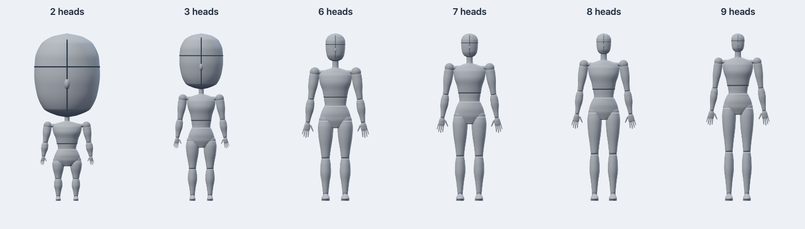
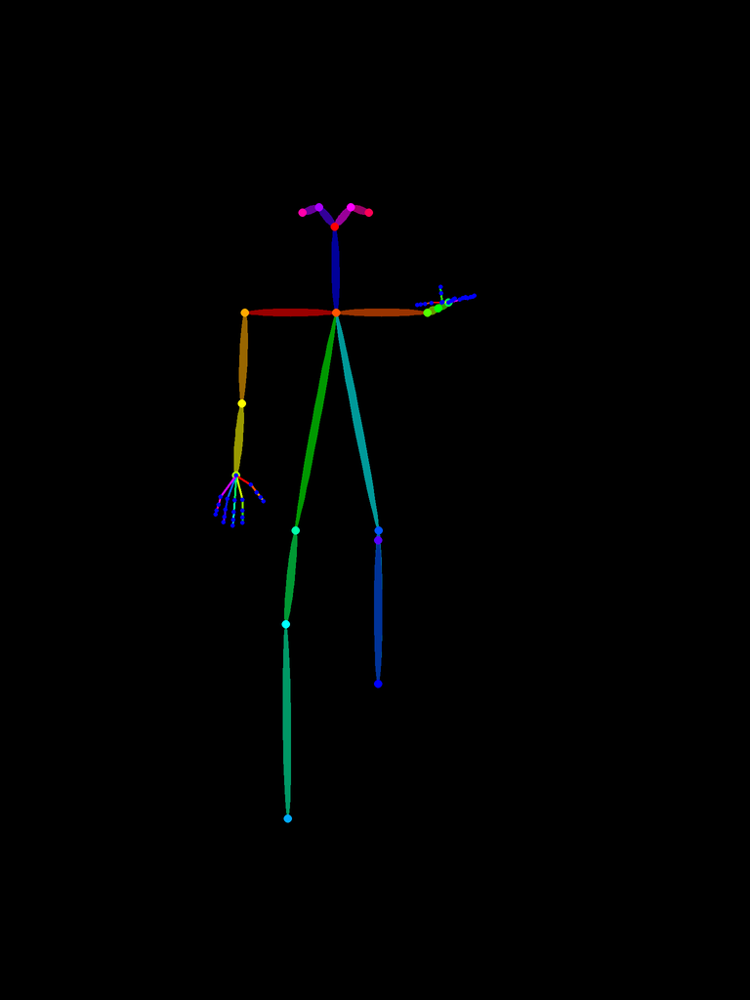
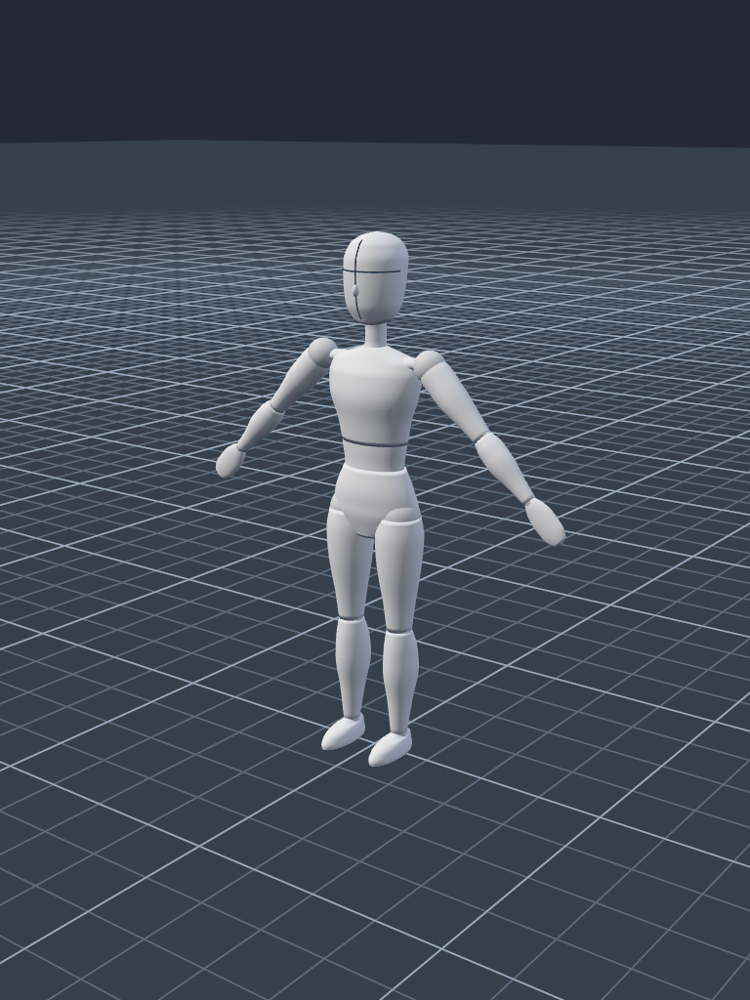
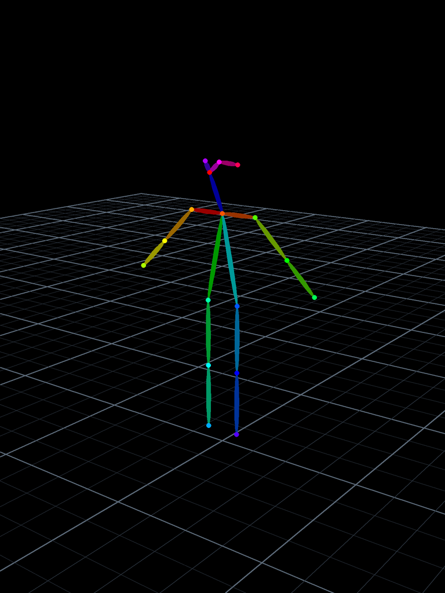

# ComfyUI-DINKIssTyle-3D-Pose

ComfyUI에서 입체 마네킹의 포즈를 만들고 촬영 카메라의 이미지를 출력하는 독립 커스텀팩입니다. 인터페이스는 영어입니다.

## 설치

이 폴더 전체를 아래 위치에 복사한 뒤 ComfyUI를 재시작하고 브라우저를 새로고침합니다.

```text
ComfyUI/custom_nodes/ComfyUI-DINKIssTyle-3D-Pose/
```

현재 저장소 안의 하위 폴더에만 두면 기존 DINKIssTyle 팩의 노드로 자동 등록되지 않습니다. 이 폴더 자체를 `custom_nodes` 바로 아래에 설치하세요. 기존 팩과 함께 사용할 수 있으며, 기존 팩 설치 없이도 동작합니다.

표준 ComfyUI 환경의 torch, numpy, Pillow, aiohttp를 사용합니다. 추가 모델 다운로드, Node.js 설치, npm 빌드는 필요하지 않습니다. Three.js 0.180.0을 로컬로 포함하므로 사용 중 CDN 연결도 필요하지 않습니다.

## 사용

1. `DINKIssTyle/3D Pose`에서 **DKST 3D Pose**를 추가합니다.
2. **Open 3D Pose Editor**로 편집기를 엽니다.
3. 등신과 기본 포즈를 선택하고 관절을 조절합니다.
4. 촬영 구도를 정한 뒤 **Apply render**을 누르거나 편집기를 닫고 ComfyUI에서 실행합니다. 실행 시 최신 장면을 자동 렌더합니다.
5. `image` 출력을 Preview Image, Save Image 또는 다음 처리 노드에 연결합니다.

[예제 워크플로](example_workflows/basic_pose.json)를 ComfyUI에 끌어 놓으면 포즈 노드와 Preview Image가 연결됩니다.


## 인체와 관절

모델은 등신별 비율 표와 부위별 곡면 메시로 구성합니다. 흉곽에서 허리로 이어지는 윤곽, 골반, 턱과 두상, 팔다리의 굵기 변화, 손바닥·손가락·발 형상을 갖춘 관절식 드로잉 마네킹입니다. 성인 비율의 팔 길이는 펼쳤을 때 전체 키와 비슷하도록 조정했고, 2·3등신에서는 머리 크기와 몸의 굵기를 따로 정의합니다.



- **2 / 3 / 6 / 7 / 8 / 9등신**. 중립 자세에서 전체 높이/머리 높이로 정의하며, 포즈의 화면상 높이와 구분합니다.
- 골반·허리·가슴·목·머리, 좌우 쇄골·어깨·팔꿈치·손목·고관절·무릎·발목·발가락 기저부, 양손의 각 손가락 3개 관절을 제어합니다.
- 인체 부위를 클릭하거나 관절 목록에서 선택합니다. 회전 링을 드래그하거나 X/Y/Z 각도를 입력합니다. 내부 회전은 quaternion으로 저장합니다.
- `Root`를 선택하고 **Move**을 누르면 인체 위치를 이동합니다.
- 손목 또는 발목을 선택하고 **Hand / foot IK**를 누르면 금색 목표점으로 팔다리를 움직입니다. **Bend pole** 또는 보라색 핸들로 팔꿈치·무릎 방향을 조절합니다.
- 관절 제한, 좌우 반전, 한쪽 포즈 복사, 선택/전체 초기화, 실행 취소/다시 실행을 지원합니다. IK의 팔꿈치·무릎은 굽힘 제한을 적용합니다. IK의 어깨·고관절은 목표점을 향해 회전합니다.
- T-pose, A-pose, 편하게 서기, 앉기, 쪼그려 앉기, 걷기, 달리기, 한 팔 들기 프리셋을 제공합니다. 앉기 프리셋은 의자 소품을 포함하지 않습니다.
- 얼굴은 두상 곡면을 따라가는 세로 중심선과 가로 눈썹 기준선, 작은 코로 방향을 표시합니다. `Face construction guides`로 선을 켜거나 끕니다. 앞면에 붙어 있는 선은 깊이 가림이 적용됩니다. [드로잉의 중심선·눈썹선 참고](https://www.proko.com/course-lesson/how-to-draw-the-head-front-view).
- `Simplify hands`는 손 전체를 하나의 둥근 형태로 표시하고 OpenPose 손가락 키포인트도 생략합니다. `Simplify feet`는 발과 앞꿈치를 하나의 형태로 합쳐 발가락 관절의 분리선을 없앱니다. 두 옵션을 꺼도 이전 손가락·발가락 회전 값이 유지되어 상세 형태로 다시 확인할 수 있습니다.

## 카메라

| 기능 | 조작 |
|---|---|
| 외부 편집 | 드래그로 편집 시점 회전, 우클릭으로 팬, 휠로 확대·축소 |
| 촬영 카메라 배치 | **Select camera** 후 이동/회전 기즈모 또는 속성의 위치·각도 입력 |
| 장면 맞춤 | 인체와 촬영 카메라를 함께 볼 수 있도록 편집 시점을 배치 |
| 카메라 보기 | 메인 캔버스를 실제 출력 화면비의 촬영 시점으로 전환 |
| 촬영 카메라 이동 | **Lock camera** 해제 후 드래그·팬·휠, 캔버스에 포커스를 두고 WASD·Q/E, Shift로 빠르게 이동 |
| 현재 시점 → 카메라 | 외부 편집 시점의 구도를 촬영 카메라에 복사 |
| 인체 맞춤 | 현재 촬영 방향을 유지하면서 인체가 프레임에 들어오도록 거리/직교 크기를 조절 |

원근 FOV와 직교 크기를 각각 조절할 수 있습니다. 작은 촬영 미리보기에는 최종 이미지의 구도가 표시됩니다. 편집 시점과 촬영 카메라는 별도로 저장됩니다. 카메라 선택 시 외부 편집에서 촬영 범위 가이드가 표시됩니다.

## 출력과 저장

- 해상도: 가로·세로 각각 **64–4096px**. 브라우저 GPU가 지원하는 최대 크기의 제한도 적용됩니다.
- 배경색·인체 색·조명·투명 배경을 설정할 수 있습니다. `Render floor grid`를 켜면 실제 출력 이미지에 원근 바닥 그리드를 포함합니다. 작은 격자와 굵은 주 격자를 구분하고, 멀어져 너무 촘촘해지는 선은 흐리게 처리합니다.
- `IMAGE`: `[1,H,W,3]` RGB float32. 투명도는 별도의 마스크로 전달합니다.
- `MASK`: `[1,H,W]` float32, **투명 부분 1 / 불투명 부분 0**, 경계는 중간값. 불투명 배경 출력의 마스크는 모두 0입니다.
- 편집용 관절 마커·기즈모·카메라 가이드는 출력에 포함하지 않습니다. 편집용 그리드는 출력용 바닥 그리드와 구분됩니다.
- **Save pose**은 등신·인체 위치·관절만 저장합니다. **Save scene**은 촬영 카메라·외형·해상도까지 포함합니다. JSON 불러오기로 복원합니다.
- 편집 내용은 워크플로에 저장됩니다. 렌더는 실행 요청별로 고정되므로 실행 준비 중 추가 편집은 다음 실행에 반영됩니다.
- 렌더 PNG와 검증 메타데이터는 `ComfyUI/input/dkst_3d_pose/`에 불변 ID로 저장됩니다. 서버 재시작 후 재사용할 수 있고, 다른 서버로 워크플로를 옮기면 브라우저에서 자동으로 다시 렌더합니다.
- 오래된 저장 이미지를 정리할 때는 해당 PNG와 같은 이름의 JSON을 함께 지우세요. 브라우저 실행은 누락된 이미지를 재생성합니다. API 단독 실행은 저장 이미지가 필요합니다.
- 최초 마네킹으로 저장한 장면은 브라우저에서 새 모델 버전으로 자동 갱신합니다. 관절 회전·카메라 설정은 유지하고, 이전 모델의 렌더 이미지는 새 모델로 다시 생성합니다.

## OpenPose 출력

**DKST 3D Pose → OpenPose**를 추가하고 기존 **DKST 3D Pose**의 `pose` 출력을 연결합니다. [OpenPose 예제 워크플로](example_workflows/openpose.json)는 마네킹 이미지와 OpenPose 이미지를 각각 미리보기 노드로 연결합니다. 기존 `image`·`mask` 출력 슬롯은 유지됩니다.

```text
DKST 3D Pose ── image ──────────────────────── Preview Image
           └── pose ── DKST 3D Pose → OpenPose ── image ── Preview Image / ControlNet
```

| 출력 | 내용 |
|---|---|
| `image` / IMAGE | 검은 배경의 COCO-18 컬러 포즈 맵, 원래 촬영 카메라와 동일한 해상도·구도 |
| `keypoints` / POSE_KEYPOINT | ComfyUI ControlNet Auxiliary와 같은 프레임 목록 구조. x/y는 0–1 정규화 좌표 |
| `openpose_json` / STRING | OpenPose의 `people`, `pose_keypoints_2d`, `hand_left_keypoints_2d`, `hand_right_keypoints_2d` 형식. x/y는 출력 이미지의 픽셀 좌표 |

몸 18개, 양손 각각 21개 키포인트를 지원합니다. 추가 포즈 검출 모델을 설치하지 않고 3D 관절을 촬영 카메라로 직접 투영합니다. `Include body`, `Include fingers`, `Include head landmarks`로 출력 부위를 선택하고 `Line width`와 `Joint radius`로 선·점 크기를 조절합니다. `Include fingers`를 끄면 몸의 손목 점까지 남기고 21점 손가락 표현을 생략합니다. 3D 장면에서 `Simplify hands`를 켠 경우에도 손가락을 생략합니다. COCO-18은 발목까지만 표현하므로 OpenPose에 발가락 키포인트는 원래 포함되지 않습니다.

`Include floor grid`는 3D 장면에서 바닥을 켰을 때 같은 카메라로 투영한 그리드를 OpenPose 이미지에도 표시합니다. 평범한 검은 배경의 OpenPose 조건 이미지가 필요하면 이 옵션을 끄세요. 그리드는 이미지에만 표시하며 표준 `POSE_KEYPOINT`와 JSON에는 추가 필드를 넣지 않습니다. 얼굴 기준선과 마네킹 표면도 OpenPose 출력에 포함되지 않습니다.

몸 순서는 **Nose, Neck, RShoulder, RElbow, RWrist, LShoulder, LElbow, LWrist, RHip, RKnee, RAnkle, LHip, LKnee, LAnkle, REye, LEye, REar, LEar**입니다. 손은 손목과 엄지·검지·중지·약지·소지의 각 4개 점을 사용합니다. Neck는 표준 OpenPose 방식에 맞춰 양 어깨의 중점으로 계산합니다.

화면 밖, 카메라 뒤, 촬영 깊이 범위 밖의 점은 `[0,0,0]`으로 처리합니다. 유효한 점의 c 값은 1이며 모델 검출의 확률 대신 투영 가능 여부를 나타냅니다. 몸·손의 관절은 다른 신체 부위에 가려져도 투영하는 X-ray 방식입니다. 머리의 코·눈·귀는 단순 두상에서 정의한 가상 점이며, 뒤통수와 측면의 먼 눈·귀는 제외합니다. **70점 얼굴 표정 랜드마크와 BODY_25는 포함하지 않습니다.** `face_keypoints_2d`는 빈 배열입니다.

포즈 맵과 키포인트를 렌더 PNG와 함께 저장하므로 서버 재시작 후에도 같은 결과를 재사용할 수 있습니다. 이전 버전의 PNG에 키포인트가 없으면 브라우저에서 다시 큐에 넣을 때 자동으로 재생성합니다.



바닥과 단순한 손·발이 포함된 [예제 워크플로](example_workflows/simplified_floor.json):




형식 참고: [OpenPose JSON 문서](https://github.com/CMU-Perceptual-Computing-Lab/openpose/blob/master/doc/02_output.md), [ControlNet 컬러·연결 순서](https://github.com/lllyasviel/ControlNet/blob/main/annotator/openpose/util.py), [ComfyUI Auxiliary의 POSE_KEYPOINT 출력](https://github.com/Fannovel16/comfyui_controlnet_aux/blob/main/node_wrappers/openpose.py).

## 현재 범위

한 명의 마네킹을 편집하는 버전입니다. 브라우저의 WebGL로 렌더하기 때문에 최초 출력과 포즈 변경 후 출력에는 브라우저가 필요합니다. **브라우저 없이 장면 JSON만으로 새로운 포즈를 렌더하는 서버 기능**과 **연결 입력으로 실행 시 등신·해상도를 바꾸는 기능**은 지원하지 않습니다. 노드 위젯이나 편집기에서 설정하세요.

Depth·Normal 출력, 외부 리깅 모델, 여러 인물·소품·애니메이션은 후속 확장 범위입니다. 입체 마네킹은 파라미터로 만든 관절식 모델이며 스킨 메시 인체 모델은 아직 포함하지 않습니다.

## 검증

팩 폴더에서 실행합니다.

```bash
npm test
python -m pytest -q --import-mode=importlib --confcutdir=tests --rootdir=tests tests/test_backend.py tests/test_openpose.py
```

브라우저 검사에는 Playwright와 Chrome/Chromium이 필요합니다. 실제 편집기와 Python IMAGE/MASK 경로를 사용하는 독립 테스트 서버를 실행합니다.

```bash
python tests/browser_harness.py
# 별도 터미널
node tests/browser_smoke.mjs
```

필요하면 `PLAYWRIGHT_MODULE`, `CHROME_PATH`, `POSE_TEST_URL` 환경 변수로 테스트 런타임을 지정할 수 있습니다. 테스트 서버는 실제 ComfyUI 그래프 UI를 대신하는 작은 하네스를 사용하므로, 사용하는 ComfyUI 버전에서의 최종 설치 확인도 필요합니다.

라이선스: 이 팩 코드는 Apache-2.0, 포함한 Three.js는 [MIT](web/vendor/LICENSE.three)입니다.
