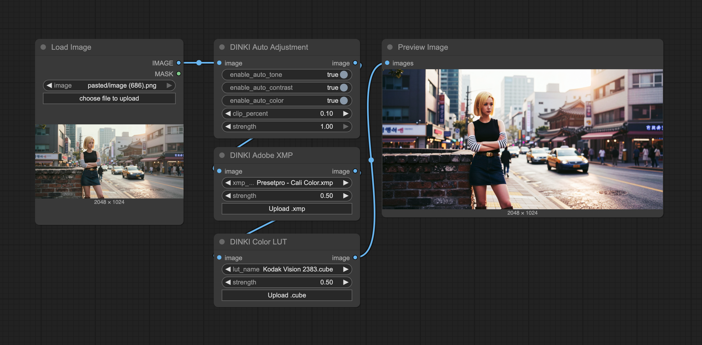

[Home](../README.md) · [All nodes](Node_Catalog.md)

# Color nodes

The eight adjustment nodes accept an `IMAGE` and return an `IMAGE` in `DINKIssTyle/Color`. Photo Studio Source loads an image file into an `IMAGE`.

## DKST Color (Photo Studio)

A separate all-in-one rendered-photo editor. Connect `image`; optionally connect `depth_image` for Lens Blur. `active` bypasses every adjustment. The compact node shows Active, Preset, Open Photo Studio, and a thumbnail. The button opens a large editor outside the graph transform, with Light, Color, Effects, Detail, Optics, and Lens Blur panels. Graph zoom does not change editor layout. `depth_near_is_white` reverses the depth convention when needed. `grain_seed` makes grain repeatable. Neutral defaults pass the input through exactly; RGB and RGBA are supported. Alpha is unchanged by color adjustments and warped with RGB by Distortion.

Numeric photo controls use sliders that show their values; `grain_seed` remains a number input. The rendered-image Temperature control uses a relative -100 to +100 scale rather than RAW Kelvin; Exposure uses -5 to +5 stops. Most signed tone, color, and effect controls use -100 to +100, and strength-only controls use 0 to 100. Both Effects Vignette and Optics Vignette accept -100 to +100: negative darkens corners, positive brightens them. These ranges and control directions follow Camera Raw where applicable, but the pixel-processing formulas are independent approximations. The Bokeh control is a simulated f-number from f/0.1 to f/30; Camera Raw itself offers Bokeh shape choices rather than an f-number control. Aperture Blades is an integer slider from 5 to 18, defaulting to 9.

Adobe references: [color and tonal adjustments](https://helpx.adobe.com/camera-raw/desktop/using/make-color-tonal-adjustments-camera.html), [manual lens correction](https://helpx.adobe.com/sg/camera-raw/desktop/using/correct-lens-distortions-camera-raw.html), and [Lens Blur](https://helpx.adobe.com/in/camera-raw/desktop/edit-and-enhance-images/sharpening-and-noise/lens-blur.html).

Lens Blur requires a depth image when Apply is on. Depth batch size must be 1 or match the image batch; its aspect ratio must match, but its resolution may differ. Focus is a normalized depth value from 0 to 1, and a smaller Bokeh f-number increases simulated defocus. Defocused layers use a polygon aperture kernel, so Aperture Blades changes the shape of blurred highlights in the image. At f-numbers above 8, isolated bright points also receive subtle simulated diffraction rays: odd blade counts produce twice as many rays, and even counts produce the same number of rays as blades. These effects are approximations, not a physical lens simulation. White Balance works on rendered pixels; Custom Temperature and Tint are relative corrections, not Kelvin or camera raw metadata. Effects Vignette adds a creative edge adjustment, while Optics Vignette corrects or adds edge falloff.

Depth Blur Radius and Depth Sigma smooth the incoming depth map with the same normalized Gaussian kernel as ComfyUI's Blur Image node before Lens Blur. Their defaults are 5 and 2.0; Radius accepts 0–31 and Sigma 0.1–10.0. Radius 0 disables smoothing. The depth preview shows the smoothed map, so clicking it selects the depth value used by the renderer. These settings have no effect on the output when Lens Blur Apply is off.

The Lens Blur renderer aligns lower-resolution depth to image edges, protects the focused depth at object boundaries, and composites depth layers in linear light. It increases depth sampling for larger blur radii and retains isolated point lights as aperture-shaped bokeh; Bokeh Boost affects those lights instead of brightening whole regions. This improves silhouettes and highlight shape at the cost of more processing time than the earlier renderer. Depth maps with missing or incorrectly placed objects still need correction upstream.

Focused content is composited at its actual depth, so defocused foreground objects can overlap a focused background without the background cutting through them. The renderer uses only visible image color at depth boundaries; guessed hidden-background color caused ghost outlines in real images. Wider focus-edge protection is reserved for depth maps that had to be enlarged; full-size maps retain a narrower focus range. A wrong silhouette in the depth map can still appear in the blur and should be corrected in the depth map.

Open Photo Studio before running a workflow when its input comes from a Load Image file or an existing image preview. You can also choose a workflow image or import a file inside the editor. An unexecuted crop, sampler, composite, or other intermediate operation cannot be previewed by substituting an ancestor's image. Run that operation once, or choose an available image explicitly. Executing Photo Studio captures its actual first input frame and connected depth map in a bounded CPU cache, independent of the adjusted output.

Image nodes with available files or previews have an **Open in Photo Studio** context-menu entry. Apply from that entry creates a new Photo Studio branch at the real IMAGE source. Existing branches stay connected. If a preview represents a selected batch frame or an ambiguous output, Apply preserves the selected file in `input/dkst_photo_studio/` and creates a Photo Studio Source node. Imported files use the same source node. The loader preserves RGBA and 16-bit grayscale depth; existing Load Image connections use the installed core loader's interpretation. It loads the first file frame only.

Choose a depth map from the editor's workflow thumbnail picker or import a depth file. Its scene, crop, orientation, and aspect ratio must match the main image; resolution may differ. A selected depth IMAGE origin is connected only on Apply. Clear disconnects it only on Apply. Show Depth displays smoothed, polarity-corrected depth after distortion. Pick Focus samples the original float depth at the clicked image coordinate, including zoom, letterboxing and distortion, and shows a focus marker. The same Focus value applies to every frame when the graph input is a batch.

The editor previews changes through the same Python engine without queuing the workflow. Fast Preview processes a proxy up to 1024 pixels on its longest side; spatial effects, grain and Lens Blur can differ from the final full-resolution output. Original Resolution Processing runs the engine on the first source frame at its original resolution, then downsizes only the displayed PNG (up to 1400 pixels). Zoom enlarges the displayed preview; it is not a 1:1 original-pixel view. CPU preview jobs are limited and coalesced; older responses cannot replace newer drafts.

Apply saves draft parameters and chosen connections, then closes the editor. Run the workflow to update downstream IMAGE outputs. Cancel and Escape discard draft adjustments and connection selections. Save Preset is a separate persistent action. Undo/Redo tracks adjustment gestures; image selections are outside that history. Changing the workflow or removing the edited node closes the editor. Refresh Input picks up a newly executed source while retaining the draft settings.

Preview sessions expire after 30 idle minutes, retain at most 16 sources/sessions and 512 MiB of tensor data, and limit each source to 256 MiB and 16 megapixels. File inputs are limited to 128 MiB. These limits affect editing previews, not normal full-resolution Photo Studio execution. An expired capture falls back to an available linked image file; otherwise the next normal workflow execution invalidates Photo Studio's stale UI cache and captures its input again. Session tokens and preview PNGs are not saved in workflow properties.

Preset selects a saved set of widget values. Save overwrites the selected personal preset; Save As creates a new one. The protected Default restores neutral values, and Custom keeps the current widget values. Presets are stored per ComfyUI user. Workflows store the actual widget values, so they remain reproducible without the preset file.

Workflows save Photo Studio controls by name as well as in ComfyUI's positional widget list. On load, the named values take precedence, preventing a new widget or visual separator from shifting values to a different control. Older positional workflows and presets receive the new depth-smoothing defaults.

Auto calculates all six Light controls from the selected original and sets Color White Balance to Auto in the draft. It works without a workflow run when a file or captured input is available. Reset restores all 32 adjustment defaults and leaves Active unchanged. Connected parameter inputs remain authoritative and are locked in the editor; the preview uses their stored widget values and reports that limitation.

Restart ComfyUI after updating the Python module, then hard-refresh the browser to load the new editor and CSS. The original Photo Studio node ID and parameter schema are preserved.

## DKST Color (Photo Studio Source)

A file-backed IMAGE loader used by Photo Studio for imported files and selected preview snapshots. `image` is a path relative to the ComfyUI input directory. `interpretation` selects Image (RGB/RGBA) or Depth Map (including normalized 16-bit grayscale depth). It reads the first frame, preserves file precision where supported, and validates paths inside the input directory. File contents participate in execution-cache invalidation. Select files through the editor rather than entering absolute paths.

## DKST Color (Auto Adjust)

Enable any combination of `enable_auto_tone`, `enable_auto_contrast`, `enable_auto_color` (on by default), and `enable_skin_tone`. Auto tone adjusts median luminance toward a balanced midtone; auto contrast stretches luminance using the low and high percentiles selected by `clip_percent`. Auto color estimates neutral balance from midtone, low-saturation pixels and reduces correction when there are too few of them. Skin tone correction is limited to likely skin-colored areas. `strength` blends the correction with the original image. RGB and RGBA images are supported; alpha is preserved.

## DKST Color (Adobe XMP)

Select an `.xmp` file from the ComfyUI `input/adobe_xmp` folder and set `strength` from 0 to 1. The node approximates exposure, contrast, saturation, vibrance, master/RGB tone curves, HSL, post-crop vignette, and grain settings. Exposure assumes an sRGB image and is applied in linear-light RGB. `grain_seed` makes grain repeatable. Unsupported Camera Raw settings are reported in the server log; malformed presets produce an error instead of silently leaving the image unchanged. RGB and RGBA images are supported; alpha is preserved. `-- None --` passes the image through. This folder is created when the extension loads.

This node applies selected XMP settings to an already rendered image. Camera profiles, raw white balance, local edits, and other unsupported settings cannot be reconstructed by this node, so results will not exactly match Adobe Camera Raw or Lightroom. For example, its vibrance and vignette formulas remain approximations.

## DKST Color (XMP Preview)

Uses the same XMP controls. After the node has run with an image, its frontend preview can show changes to the preset, strength, or grain seed without queueing the whole workflow again. Each execution has its own preview image; the preview cache retains the eight most recent executions and limits the longest preview side to 1024 pixels. The node still returns the full-resolution processed image when executed.

## DKST Color (LUT)

Select a 3D `.cube` file in ComfyUI `input/luts` with `lut_name`; `strength` blends the LUT result with the input. RGB and RGBA inputs are supported; only RGB is color graded, and alpha is preserved. The folder is created when the extension loads. `-- None --` passes the image through.

## DKST Color (LUT Preview)

Uses the same `lut_name` and `strength` controls as LUT. Run the node once to supply an image for the interactive frontend preview, then adjust the LUT or strength to inspect the effect. It returns the processed image when executed.

## DKST Color (Oversaturation Fix)

`fix_enabled` bypasses the correction when off. Choose `desaturate_highlights`, `global_desat`, `chroma_limit`, or `auto` with `mode`. `saturation_reduction` and `highlight_threshold` control highlight desaturation; `max_chroma` limits chroma; `preserve_skin_tones` protects skin hues in highlight mode. `strength` blends the correction with the source.

## DKST Color (Deband)

Reduces visible banding with a guided filter and optional grain. RGB and RGBA inputs are supported; alpha is preserved. `enabled` bypasses the node when off. `threshold` controls the smoothing tolerance, `radius` the filter neighborhood, `iterations` the number of passes, and `grain` the amount of noise added afterward. Larger radii and iteration counts take more processing time.
