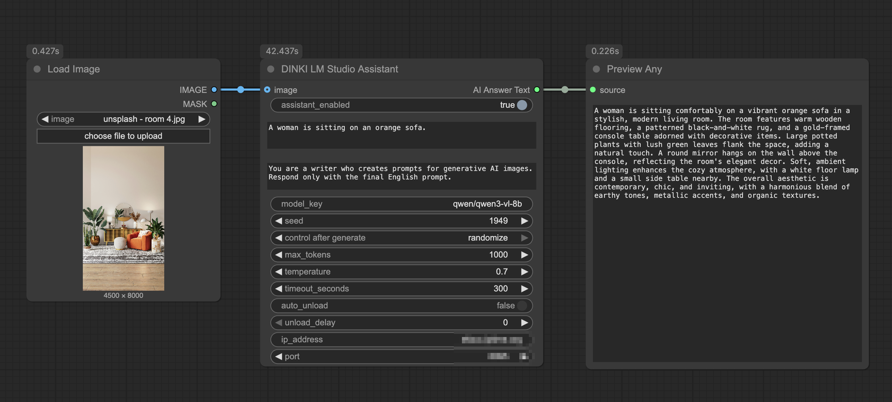
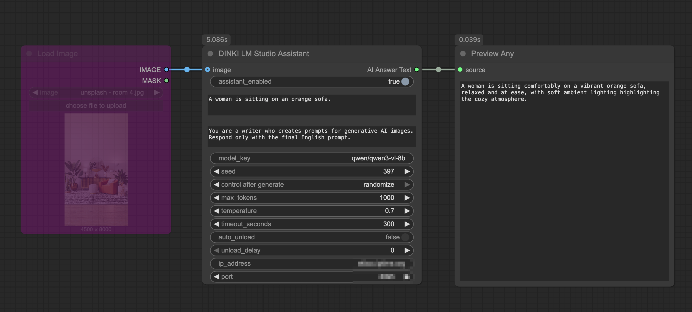
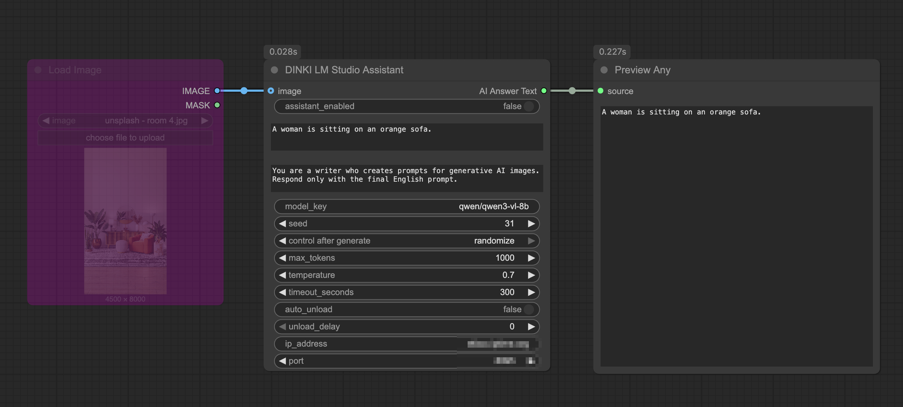

[Home](../README.md) · [All nodes](Node_Catalog.md)
- [Comparison Video Tools](DINKI_Video_Tools.md)
- [Image](DINKI_Image.md)
- [Color Nodes](DINKI_Color_Nodes.md)
- [LM Studio Assistant](DINKI_LM_Studio_Assistant.md)
- [Prompts and Strings](DINKI_Prompt_and_String.md)
- [Node Utilities](DINKI_Node_Utils.md)
- [Internal Processing](DINKI_PS.md)

## 🤖 DKST LLM (LM Studio)

**DKST LLM (LM Studio)** is a powerful bridge node that connects ComfyUI directly to **LM Studio**. It enables the use of local Large Language Models (LLMs) and Vision Language Models (VLMs) within your workflows for tasks like image captioning, prompt enhancement, and creative writing.

### ✨ Key Features

* **Multimodal Capabilities:** Supports both **Text-to-Text** and **Image-to-Text** (Vision) generation.
* **Local & Private:** Runs via your LM Studio server, with optional API key authentication.
* **Connection Aliases:** Register server connections in **Settings → DKST → LLM** and select an alias from the node dropdown. Addresses, ports and API keys are stored outside the workflow.
* **Batch Support:** Attaches each image from an input batch to one chat completion request for joint analysis.
* **Memory Management:** Includes an `auto_unload` feature to free up VRAM for Stable Diffusion generation after the LLM task is finished.
* **Flexible Control:** Full access to LLM parameters like `temperature`, `max_tokens`, and `system_prompt`.

### 🚀 Modes of Operation

#### 1. Vision Mode (Image + Text)
When an **image is connected**, the node operates as a Vision Assistant.
* The image is sent to the LLM along with your `user_prompt`.
* **Use Case:** Connect a Vision model (like Qwen3-VL or Gemma3) in LM Studio to caption images, describe styles, or analyze composition.
* *Note: If `user_prompt` is left empty, the LLM will default to "Describe the images."*

#### 2. Text Mode (Text Only)
When **no image is connected**, the node functions as a pure text generator.
* It generates text based solely on the `user_prompt` and `system_prompt`.
* **Use Case:** Prompt expansion, style generation, or creative writing.

#### 3. Passthrough Mode
By setting `assistant_enabled` to **False**, the node bypasses the LLM entirely and simply outputs your raw `user_prompt`. This is useful for A/B testing without removing the node.

### Generation mode

Choose **Always Generate** (default) to call the LLM on every workflow execution, including with a fixed seed. Choose **Generate on Change** to reuse the last successful **AI Answer Text** when the actual `user_prompt`, `system_prompt`, and image contents are unchanged. Changing the seed or using randomize does not trigger regeneration in this mode.

Image comparison uses pixel contents, dimensions, batch count and order, rather than tensor identity or the source node ID. Connecting or removing images counts as a change. Changes to `model_key`, `connection_alias`, the saved connection profile, `temperature`, or `max_tokens` also require a new answer. Timeout and unload settings do not invalidate the answer.

On a cache hit, the node sends no HTTP requests and skips image encoding and the automatic unload delay. Upstream nodes may still execute to supply the current inputs for comparison. The cache retains only the last successful answer: A → B → A generates three times. Failed or incomplete requests do not replace it and will be retried on the next execution. Passthrough mode preserves the cache.

The last answer and an input fingerprint are stored internally in the workflow; save after generation to retain them across reloads and server restarts. Original image data, connection addresses and API keys are not stored in the response cache. API clients can retain the `dkst_llm_response` UI value and submit it as `cached_response` with the same node ID to restore a saved answer; without it, the first run after a restart generates again.

### 🛠️ Prerequisites & Setup

1.  **Install LM Studio:** Download and install [LM Studio](https://lmstudio.ai/).
2.  **Load a Model:**
    * For **Text-only**: Load any LLM (Llama 3, Mistral, etc.).
    * For **Vision**: Load a vision-capable model (e.g., `Qwen-VL`, `LLaVA`, `BakLLaVA`).
3.  **Start Local Server:**
    * Go to the **Local Server** tab ( double arrow icon <-> ) in LM Studio.
    * Click **Start Server**.
    * The usual port is `1234`.
4.  **Register a Connection:** Open ComfyUI **Settings → DKST → LLM → Connections**. Enter a non-sensitive alias, IP address/hostname, port, HTTP/HTTPS protocol, and optional API key, then click **Save**. **Test saved connection** checks the saved profile against `/v1/models`.
5.  **Select the Alias:** Choose it from the node's **Connection alias** dropdown. **Refresh connections** reloads profiles changed from another browser. A missing/deleted alias stays selected and gives a configuration error instead of switching servers.

### Connection storage and workflow sharing

Profiles are shared by clients of the same ComfyUI server and stored at `<ComfyUI user directory>/dkst_llm/connections.json`. The file uses restricted permissions where supported and contains plaintext API keys; protect the server's user directory and backups. The settings editor never returns stored keys to the browser. Leave the key field empty to preserve a saved key, enter a new key to replace it, or check **Remove stored API key** to clear it. To use a different alias, create a new profile and select it on the node.

Only the alias and generation settings enter workflow/API JSON and output workflow metadata. Changing a profile invalidates the LLM node's cached result. A shared workflow can use a different endpoint on another server by registering the same alias there. API callers should submit `connection_alias`; removed `ip_address`, `port` and `api_key` inputs are stripped at the queue boundary and are not used for execution.

Opening a legacy workflow with literal connection widgets replaces the widgets with an alias and registers/deduplicates them in the background as **Migrated LLM 1**, **Migrated LLM 2**, etc. Save it again to keep the updated workflow. Pasted legacy nodes and imported API JSON also support literal connections. Registration failures do not prevent the workflow from opening: register the connection manually in settings and select its alias. Linked legacy connection inputs are disconnected while other links are preserved; remove any credential source nodes before sharing, since those source nodes may still store secrets. Unknown positional LLM widget layouts are reset with an explanation, while named generation settings are retained. Previously saved workflows, generated images/videos and backups are not modified retroactively.

Connection errors report status and configuration guidance without returning request URLs, authentication headers or raw server error bodies. Other workflow content, such as user prompts and unrelated nodes, still follows normal ComfyUI metadata behavior.

### 🎛️ Parameters Guide

| Parameter | Description |
| :--- | :--- |
| **assistant_enabled** | Master toggle. If `False`, passes input text directly to output without calling the LLM. |
| **generation_mode** | `Always Generate` calls the LLM every run. `Generate on Change` reuses the last successful answer when prompts, images and generation settings are unchanged, ignoring seed changes. |
| **connection_alias** | Registered connection selected from a dropdown. Manage addresses, ports and API keys in Settings → DKST → LLM. Authentication applies to generation and automatic unloading. |
| **model_key** | The model identifier string (e.g., `qwen/qwen3-vl-8b`). Can often be left generic depending on LM Studio version. |
| **seed** | Generation seed; `-1` chooses a time-based seed (default). |
| **system_prompt** | Defines the AI's persona (e.g., "You are a prompt engineer..."). |
| **user_prompt** | Your specific instruction or query. |
| **max_tokens** | Maximum output tokens (0–2,147,483,647). `0` omits the parameter and uses the server default. Actual output is limited by the model and available context. |
| **temperature** | Creativity control (0.0 = Precise/Deterministic, 1.0+ = Creative/Random). |
| **timeout_seconds** | Request timeout in seconds (default: 300). |
| **auto_unload** | If `True`, sends a request to unload the model from VRAM after generation. Essential for GPUs with limited VRAM. |
| **unload_delay** | Seconds to wait before unloading the model (if `auto_unload` is True). |

[With the DKST Image (Batch) node, you can request up to 10 image assistants from an LLM.](DINKI_Image.md#-dinki-batch-images)
