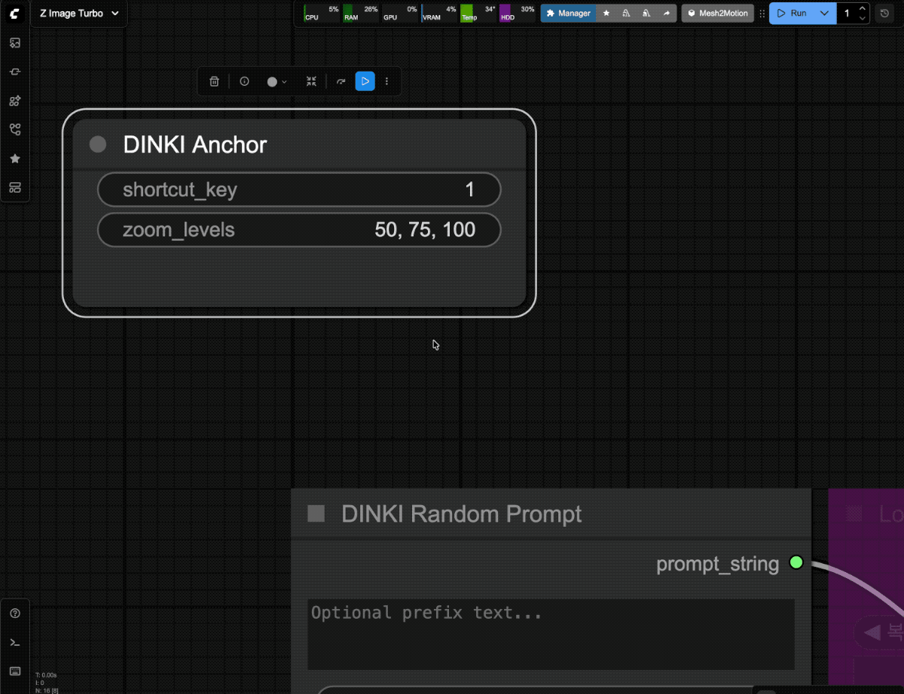
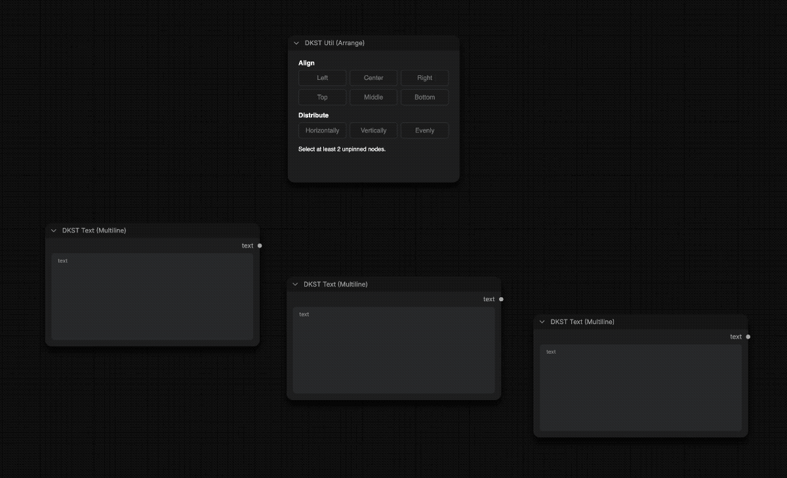
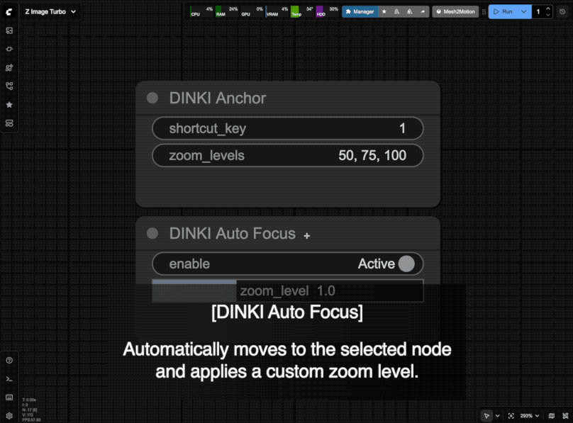
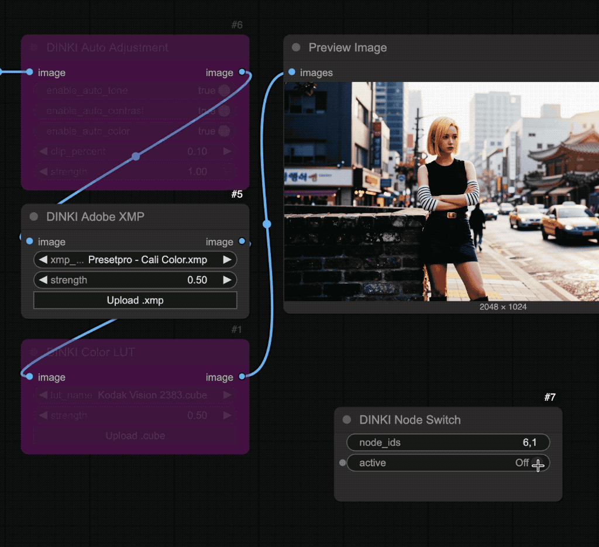
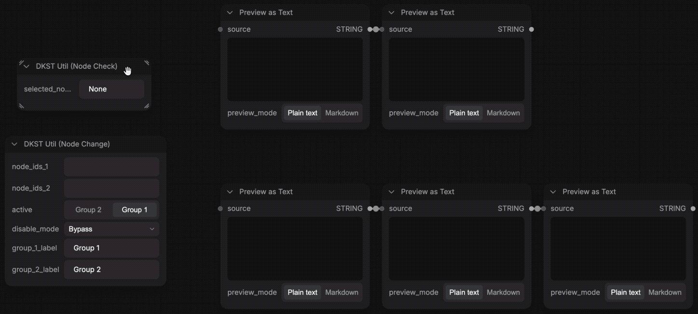
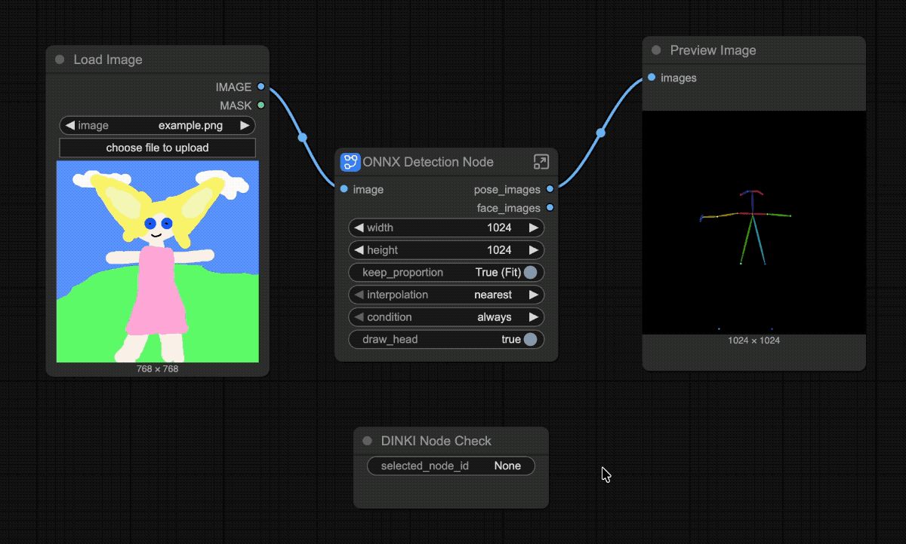

[Home](../README.md) · [All nodes](Node_Catalog.md)
- [Comparison Video Tools](DINKI_Video_Tools.md)
- [Image](DINKI_Image.md)
- [Color Nodes](DINKI_Color_Nodes.md)
- [LM Studio Assistant](DINKI_LM_Studio_Assistant.md)
- [Prompts and Strings](DINKI_Prompt_and_String.md)
- [Node Utilities](DINKI_Node_Utils.md)
- [Internal Processing](DINKI_PS.md)

## 📍 DKST Util (Anchor)

  

This node lets you quickly jump to any desired location using a hotkey, and also allows a single shortcut to cycle through multiple zoom-in and zoom-out levels sequentially.

---

## DKST Util (Arrange)

  

Multi-select workflow nodes, then click a button on this node. The buttons preserve the selection and act immediately, without running the workflow. Arrange nodes, pinned nodes, groups, and reroutes are excluded. Only nodes in the currently displayed graph or subgraph are arranged. Changes support ComfyUI Undo/Redo.

- **Align — Left / Center / Right / Top / Middle / Bottom:** align the visible node edges or centers within the selection's bounding rectangle. Requires at least two unpinned nodes.
- **Distribute — Horizontally / Vertically:** preserve spatial order and equalize the gaps between visible node edges. Requires at least three unpinned nodes. The selection's outer span is preserved when the nodes fit; overlapping selections expand enough to avoid negative gaps.
- **Distribute — Evenly:** arrange nodes in a grid anchored at the selection's top-left corner, ordered from top to bottom and left to right. Cells use the largest selected node's width and height, with 40 px between cells. The number of columns is the square root of the node count, rounded up. Requires at least two unpinned nodes.

The status line shows the number of eligible selected nodes. Buttons are disabled when too few nodes are selected. Node sizes and connections are preserved.

---

## 🧭 DKST Util (Auto Focus)

  

Automatically moves to the selected node and applies a custom zoom level. It follows selection in both classic ComfyUI and Nodes 2.0, including the currently displayed subgraph. The shortcut key toggles Auto Focus on or off.

Turn on **fit** to center the selected node and fit its full width and height inside the visible canvas with a 5% margin. Fit calculates zoom from the node's current size and the canvas viewport, up to the canvas maximum zoom (or 3× when no maximum is available). With fit off, **zoom_level** controls the zoom as before. **smoothness** applies to both modes.

Turn on **restore_on_deselect** to restore only the zoom from before the first automatic focus when all nodes are deselected. The canvas stays centered on the last viewed position as the zoom changes. Changing the selection to another node keeps the original zoom for the eventual return. This option is off by default.

---

## 🔒 DKST Util (Workflow Lock)

  

Use the **Lock / Unlock** switch to Pin every node in the workflow, including nodes inside subgraphs. Lock records each node's previous Pin state; Unlock restores it, so nodes that were already pinned stay pinned. The snapshot is saved with the workflow, allowing Unlock after reopening a locked workflow. New nodes added while locked are pinned and included in the snapshot. Multiple Workflow Lock nodes in the same workflow share one lock state.

This is a canvas control. It has no connections and does not affect image generation.

Pinned nodes display a customizable Pin icon on their title bar. You can customize the icon style (`Default`, `Lock`, `Circle`) and color (`Red`, `Orange`, `Yellow`, `Blue`, `Green`, `Purple`, `White`, `Gray`, `Black`) in ComfyUI Settings under **Other** → **DKST** → **Appearance** (`Pin Icon Style`, `Pin Icon Color`).

---

## 🎚️ DKST Util (Node Switch)

  

A logic utility node that acts as a **remote control** for your workflow. It allows you to **toggle the Bypass status** of multiple target nodes simultaneously using a simple switch.

Perfect for creating "Control Panels" in complex workflows, allowing you to turn entire sections (like Upscaling, Face Detailer, or LoRA stacks) on or off without hunting for individual nodes.

#### ✨ Key Features

* **Remote Control:** Manage the state of any node in your graph from a single location.
* **Batch Toggling:** Control multiple nodes at once by entering a comma-separated list of Node IDs (e.g., `10, 15, 23`).
* **Workflow Optimization:** Easily disable heavy processing steps (like high-res fix) during initial testing, then re-enable them for the final render with one click.
* **Frontend Integration:** Directly interacts with the ComfyUI graph interface to visually mute/unmute nodes.

#### 💡 How to Use
1.  **Find Node IDs:** In ComfyUI settings, enable **"Show Node ID on Node"** (or right-click a node > Properties to see its ID).
2.  **Input IDs:** Enter the IDs of the nodes you want to control into the `node_ids` field (e.g., `5, 12, 44`).
    The `node_ids` field is an advanced parameter: expand the node's advanced options to edit it, then collapse them to keep only the `active` switch visible. Its value is retained while collapsed.
3.  **Toggle:**
    * **On (True):** Target nodes are **Enabled** (Active).
    * **Off (False):** Target nodes are **Bypassed** (Muted).

### 🎛️ Inputs

| Parameter | Description |
| :--- | :--- |
| **node_ids** | A string of node IDs separated by commas (e.g., `1,2,3`). |
| **active** | The master switch. Toggles the bypass state of the defined nodes. |

---

## 🔀 DKST Util (Node Change)

  

Switch between two groups of nodes using comma-separated IDs in `node_ids_1`
and `node_ids_2` (for example, `5, 12, 44`).
Only the `active` switch is shown by default. Use ComfyUI's **Show advanced inputs**
control to edit the node IDs, disable mode, and toggle labels; collapse it again
to keep just the switch visible. The advanced values remain in the workflow.

* **Group 1 / On:** Enable group 1 and disable group 2.
* **Group 2 / Off:** Disable group 1 and enable group 2.
* **disable_mode:** `Bypass` (default) passes inputs through the disabled nodes;
  `Mute` stops their execution and output. Use Mute to exclude a text branch from
  DKST Text (Concatenate).
* **group_1_label / group_2_label:** Customize the toggle's two labels, including
  promoted subgraph controls. Empty names fall back to Group 1 / Group 2.
* Enabled nodes use normal execution mode. Existing workflows default to Bypass.
* Empty fields and unknown IDs are ignored. IDs in both groups stay enabled.
* The control ignores its own ID and resolves targets within its own graph/subgraph.
* Supports classic widgets and Nodes 2.0. Saved settings apply when a workflow loads.
* Controls promoted to a subgraph's outer interface are synchronized within about
  100 ms, including nested subgraphs. Target IDs still refer to the control's own
  graph. The selected group is reapplied after tab switches and workflow loads;
  unchanged target modes do not trigger redraws.

This control changes node modes in the ComfyUI frontend, like Node Switch.
For predictable results, avoid targeting the same node with conflicting controls.

The Boolean `switch` output follows `active`: Group 1 is **true**, Group 2 is
**false**. Connect it to the `switch` input of If/Else Switch or If/Else Branch
to select the matching result with the same toggle.

For two different VAE decoders, put the MiniMax decoder ID in `node_ids_1` and
the standard VAE Decode ID in `node_ids_2`, and choose **Mute**. Connect the
MiniMax IMAGE output to `on_true_1`, the standard IMAGE output to `on_false_1`,
and `output_1` to Create Video's `images`. Bypass cannot reliably pass a
decoder's LATENT/VAE inputs through as an IMAGE. Include any branch-specific
Preview/Save nodes in the same group if they also consume the disabled decoder.

Keep `active` as a manual widget or a promoted subgraph control for node mode
changes. A Boolean computed during backend execution arrives after the frontend
has exported the workflow and cannot synchronize Mute/Bypass for that queued run.

---

## 🔀 DKST Util (Node Change 3 Groups / 4 Groups)

Select one of three or four node groups with the integer `active` control.
`active` starts at **1**: the 3 Groups version accepts 1–3, and the 4 Groups
version accepts 1–4. Only `active` is shown by default, with the selected group's
name as its label. Expand **Show advanced inputs** to edit `node_ids_1` through
`node_ids_3` or `node_ids_4`, `disable_mode`, and each `group_N_label`.
Empty names fall back to `Group N`; renaming a group keeps its selected number.

* The selected group's IDs use normal execution mode; IDs only in other groups
  use Bypass (default) or Mute. Use Mute for incompatible decoder branches.
* An ID shared by several groups is enabled when it belongs to the selected group.
  For example, an ID in groups 1 and 2 is disabled when group 3 is selected.
  Put always-enabled shared nodes in every group, or leave them outside the control.
* Unknown IDs, empty entries and the control's own ID are ignored. Nodes outside
  all groups keep their current mode, including IDs removed from all fields.
* Supports classic widgets, Nodes 2.0, saved workflows, compact advanced controls
  and nested promoted subgraph controls. Targets are local to the control's graph.
* Invalid indices leave target modes unchanged and fail backend validation.

The single **`index: INT`** output equals `active`; there are no per-group Boolean
outputs. For example, `active=3` enables group 3 and outputs `index=3`. Connect
`index` to a selector accepting a 1-based integer index. If a selector requires
0-based indices, subtract 1 before connecting it. Existing Boolean If/Else sockets
require a separate comparison/conversion. A selector used with muted branches
must support evaluation of only the selected branch.

Keep `active` as a manual widget or a promoted subgraph widget. Backend-computed
indices arrive after frontend prompt export and cannot synchronize Mute/Bypass
for that queued run. Changing selection also does not modify already queued prompts.
The existing two-group Node Change and Auto Node Change keep their Boolean inputs
and outputs. These new versions do not automatically advance after execution.

---

## 🔁 DKST Util (Auto Node Change)

Uses the same two groups, custom labels, Mute/Bypass settings and Boolean `switch`
output as Node Change. Choose the initial group with `active`, then expand
**Show advanced inputs** to set `auto_mode`:

| Mode | After a successful workflow run |
| :--- | :--- |
| `Manual` | Keep the current selection. |
| `After run: Group 2` (default) | Select Group 2 for the next run, then keep Group 2 selected. |
| `After run: Toggle 1 / 2` | Select the opposite group for the next run. Starting at Group 1 gives 1 → 2 → 1 → 2. |
| `Generate on Change` | Use Group 1 for new watched settings, then select Group 2 after success. Unchanged settings keep using Group 2. |

For **Generate on Change**, set the advanced `watch_node_ids` field to the IDs
of nodes whose settings should trigger regeneration, for example `12, 25` for an
image loader and a prompt node. These IDs refer to nodes in the **same graph** as
the Auto Node Change control. No input cable is required. The comparison happens
before prompt export so that the selected group's Mute/Bypass modes and Boolean
output agree for that run.

The first run after loading the workflow or reloading the browser uses Group 1.
After the whole workflow succeeds, the browser remembers the watched settings
and selects Group 2. Changing any watched widget value (including seed) or input
connection selects Group 1 on the next submission. Changes to group membership or
disable mode also trigger Group 1. Promoted widget values and settings inside a
watched subgraph node are included. Position, size, title and node mode are ignored.
Selecting Group 1 manually forces another run even with unchanged settings.
Errors, interruptions and rejected submissions do not record new successful settings.

This compares **widget settings and connections**, not actual image/text outputs.
List every source node you want to watch; settings on unlisted upstream nodes
are not automatically included. Replacing an image file's contents under the same
filename or changing external data without a widget edit is not detected.
Custom state stored only in node properties is also outside this comparison.
Empty IDs, missing nodes, the control's own ID or unreadable settings keep Group 1
selected so that generation remains available. Successful settings are held in
browser memory; saving a workflow does not retain this comparison history.

For example, put a caption generator in Group 1 and use Group 2 to reuse a
previous caption. Keep the [Multiline Cache](DINKI_Prompt_and_String.md) enabled
in both groups to retain its text when the generator is muted. Auto Node Change
controls groups; the cache node retains the generated result.

**Not supported for queued/batch runs. Finish one run before submitting the next.**
**큐/배치 처리에는 사용할 수 없습니다. 한 번의 실행이 완료된 후 다음 실행을 시작하세요.**
Already queued prompts contain a fixed group selection. Changing the control
cannot change their execution. Overlapping submissions involving the same auto
control skip automatic updates; queued work is not rescheduled or altered.

Completion-based changes happen after the **whole workflow succeeds**, including
successful runs using cached outputs. Errors, interruptions and failed queue submissions do not
advance the selection. The current run's `switch` output stays fixed; the new
selection applies to the next run. Manual selection or mode changes during a run
are preserved if they differ from the submitted settings.

The ComfyUI browser must remain open and connected to receive completion events.
Automatic switching does not run for API-only submissions. Loading a workflow,
replaying history or receiving completion from another workflow does not advance
its selection. Promoted controls, including nested subgraphs, update along with
the inner selector. Save the workflow to retain the current selection and mode.

---

## 🕵️ DKST Util (Node Check)

  

This node for quickly checking the ID of any selected node—even when the global “Show Node ID” option is turned off.

---

## 🔀 DKST Util (Cross Switch)

A simple yet handy utility for A/B testing or routing logic. It swaps the two input images based on a boolean toggle.

#### 🎛️ Parameters Guide

| Parameter | Description |
| :--- | :--- |
| **image_1 / image_2** | The two input images to be swapped. |
| **invert** | **False:** Output 1 = Image 1, Output 2 = Image 2. **True:** Output 1 = Image 2, Output 2 = Image 1 (Swapped). |

---

## DKST Util (Note)

Choose a `direction` arrow and enter multiline `text` to annotate the workflow. The node also passes that text to its `text_out` STRING output.

## Queue progress with lazy branches

DKST If/Else Switch, If/Else Branch, and If/Else Image Switch report when they
are waiting for their selected inputs. The frontend uses that report to exclude
waiting branches from the queue overlay's **Current node**, allowing the actual
Sampler or VAE Decode name and progress to appear. This also works with chained
branches and nested subgraphs; their full execution IDs remain distinct.

The correction is enabled by default. Toggle **DKST → Progress → Show
actual processing node in queue progress** in Settings to restore native display.
Restart ComfyUI and refresh the browser after updating, since both the backend
report and the frontend extension are needed. Older backends without execution
contexts or node-level `progress_state` events retain their native progress display.
The correction affects display state only; branch selection and data outputs
use the same lazy execution behavior.

## DKST Util (Execution Report)

Add this node anywhere in the workflow **without connections**, leave `enabled`
on, and run the workflow. After the entire execution finishes, the node displays
a Markdown table with node names (including execution IDs), processing times,
and each node's share of the processing time sum. **Copy Markdown** copies the
complete report. `sort_by` chooses execution order or longest processing time
first for the next run. The last report is included in execution history and can
also be saved with the workflow.

Check **Hide 0.000 s** in the report toolbar to immediately hide rows whose
displayed processing time is `0.000 s`, including smaller times rounded to that
value. **Copy Markdown** uses the filtered table. Totals and percentages keep
their original values, and Cached rows remain visible. Uncheck it to restore
the rows without running again. The checkbox state is saved with the workflow.

Both **Node processing time sum** and **Workflow elapsed time** are displayed.
Share is `node processing time / node processing time sum × 100`; it is zero
when the sum is zero. Parallel async work can make the sum exceed elapsed time.
The workflow elapsed time starts when the server begins execution, excluding
time waiting in the queue. Interrupted and failed runs show a partial report.

Timing is measured on the server around `get_output_data`, after lazy inputs
have resolved. It covers the node function and its output conversion, including
model loading and external requests made by that function. It does not include
waiting for upstream nodes, the executor's later UI/cache bookkeeping, or graph
expansion children in the parent's time. Async Tasks keep their native scheduling
and are timed until completion; repeated invocations of one execution ID are
summed. Subgraph IDs such as `105:8` and `106:8` remain separate.

Only visited cache hits appear as **Cached**, with no time added. Unexecuted
branches and cache entries the execution never visits are omitted. A cached
downstream result can skip its entire upstream path, so that path has no rows.
The report node itself and nodes whose calls are all silently blocked are
excluded from the table. Timing uses elapsed server time rather than isolated
GPU kernel time and does not force GPU synchronization.

Restart ComfyUI and refresh the browser after installing. The extension observes
the execution API at runtime without editing ComfyUI core files. Workflows with
no enabled report node are not timed. Both modern async and older synchronous
executors with the lazy execution API are supported; incompatible execution
signatures leave normal generation intact and show **Unavailable** in the node.
